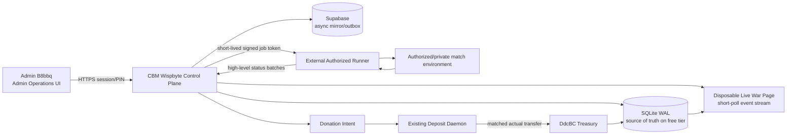

# Implementation Plan: CBM Admin UI Overhaul and Two-Clan War Control Plane

**Project:** `G:\TerriX`  
**Authoritative CBM runtime:** `cbm_wispbyte/`  
**Primary operator:** Admin account `B8bbq`  
**Vault account:** `DdcBC`  
**Hosting constraint:** Free Wispbyte instance, maximum **15% average usage of 0.35 vCPU** (`0.0525 vCPU` equivalent average budget)

## 1. Executive decision

Build a low-CPU **CBM control plane** on Wispbyte and keep gameplay execution on an external, explicitly authorized runner. Wispbyte will own:

- admin authentication and authorization;
- bot-account inventory and capital accounting;
- war configuration and lifecycle state;
- signed, short-lived commands for an external runner;
- aggregated bot telemetry and profit/loss accounting;
- a disposable live-war page and a durable post-war summary.

Wispbyte will **not** run Chrome, headless browser sessions, a high-frequency game simulation, a proxy pool, a CAPTCHA/anti-bot bypass, or one WebSocket connection per bot. Those workloads cannot be guaranteed under the stated CPU budget and should not be placed on the free instance.

The first release is limited to **one active war and a small runner-reported bot set**. The default should be four bot slots or fewer until a measured soak test proves that a higher limit is safe.

This plan assumes that automation is used only in a private/custom/authorized match or another environment where the game operator permits it. It deliberately excludes anti-detection, CAPTCHA bypass, proxy rotation, and unauthorized public-player targeting. The runner interface receives high-level match events rather than instructions for evading platform controls.

## 2. Repository findings that shape the plan

### Existing authoritative surfaces

- `cbm_wispbyte/main.py` is the production HTTP runtime, static-page router, API dispatcher, cache initializer, and daemon bootstrap.
- `cbm_wispbyte/db_layer.py` is the SQLite/Supabase persistence layer. SQLite already uses WAL mode and thread-local connections.
- `cbm_wispbyte/deposit_daemon.py` already polls the public transaction ledger and matches web-declared donation intents before calling `record_direct_donation()`.
- `cbm_wispbyte/gold_api_client.py` is the existing official HTTP wrapper for account and gold operations. It should be used only for authorized, auditable operations; it must not receive new credential-bypass behavior.
- `cbm_wispbyte/cbm.html`, `vault.html`, and `donations.html` already establish the PayPal-dark visual language, treasury metrics, donation flow, and telemetry charts.
- `cbm_wispbyte/` is the only permitted home for new CBM pages, routes, backend modules, and schema work. `web/` is deprecated and must remain untouched.
- `src/` is the only permitted home for active TerriX client-mod code. `client/` remains generated output and must never be edited directly.

### Current gaps

- There is no durable bot-account inventory, bot investment state machine, war entity, war event stream, or disposable war page.
- There is no role-gated Admin B8bbq workspace. The current `cbm.html` is primarily a member treasury portal.
- The HTTP server has no native WebSocket endpoint. A new WebSocket dependency would add runtime and operational cost.
- `main.py` currently starts a deposit daemon, active status probing, an AI-session GC thread, a tunnel supervisor, and an optional Discord process. Their combined default activity must be reduced or made war-aware before adding a live-war feature.
- The codebase contains legacy/off-host gameplay automation paths under `scripts/`. They must not be imported into the Wispbyte runtime. The new backend should communicate with a narrow worker protocol instead of coupling to low-level game frames.
- The repository contains credential/key material and hard-coded client API tokens in existing files. Secret rotation and removal from distributable client code are prerequisites for production rollout; no secret values belong in this plan or in new code.

## 3. User-visible outcome

Admin B8bbq opens a new **Admin Operations** page and can:

1. review treasury/reserve headroom, Wispbyte CPU guard status, runner health, and current bot inventory;
2. allocate a whole-Gold investment to a bot account;
3. see the computed target and payout before confirmation;
4. keep the bot in `READY` state after a completed run so it can be reactivated while the external account still exists;
5. configure a two-clan war with immutable names, tags, logos, map, side assignment, bot plan, and capital cap;
6. launch a disposable live-war page showing head-to-head animation, bot status, map updates, and financial telemetry;
7. press one authenticated **End War** command that stops future bot commands, closes the live page, and then exposes a durable summary of war profit, losses, transfers, and unresolved risk.

The live page is a route backed by database state, not a generated HTML file per war. “Delete the page” means that the live route is invalidated and returns `410 Gone` or redirects to the summary; the audit record remains available.

## 4. Economic contract and invariants

All monetary values are stored and calculated as integer cents. Floating-point values are display-only.

For an investment `I`:

```text
target_balance = I + (I * 2) = 3I
earned_payout  = target_balance - I = 2I
```

Example:

```text
investment      = 10.00 Gold
target balance  = 30.00 Gold
earned payout   = 20.00 Gold to DdcBC with WAR_PROFIT donation intent
bot final state  = READY, not RUNNING
```

Required invariants:

- the original `I` remains attributed to the bot account and is not counted as war profit;
- payout is capped at `2I`; a worker cannot request more than the plan authorizes;
- a payout intent is created before an external transfer is attempted;
- the deposit daemon may claim an intent only once, using the existing replay-protection transaction hash plus a war/bot intent identifier;
- `record_direct_donation()` records the actual received amount as irrevocable reserve capital, not as a member liability;
- a completed payout transitions the bot to `READY`, never directly back to `RUNNING`;
- a missing/deleted external account transitions to `ACCOUNT_MISSING` and is not automatically recreated;
- manual stop is idempotent and never creates duplicate payouts;
- every capital allocation, payout intent, payout claim, loss, and stop command has an audit row and a ledger reference.

### Profit and loss definitions

The live and final views show the components separately:

- **Capital committed:** total `I` reserved for bots in this war;
- **Gross earnings:** external runner-reported earnings above each bot's investment baseline;
- **Vault inflow:** actual matched `WAR_PROFIT` donations received by `DdcBC`;
- **Transfer/game fees:** verified fees associated with authorized transfers;
- **Capital at risk:** committed investment not recovered or not present when the account is reconciled;
- **War profit:** `vault inflow - capital loss - verified fees`;
- **War loss:** capital at risk plus verified fees when the result is negative.

## 5. Target architecture



### Control-plane responsibilities

`cbm_wispbyte/` owns the state machine and accounting. The external runner owns the browser/game session and reports only normalized observations such as `LOBBY_FOUND`, `SPAWNED`, `TARGET_REACHED`, `PAYOUT_REQUESTED`, `ACCOUNT_MISSING`, and `STOPPED`.

The runner should pull commands over outbound HTTPS (`GET /api/worker/v1/commands`) or use a single outbound connection from the runner. Wispbyte does not need to accept inbound connections from the runner and does not need a WebSocket server.

### Cheapest live transport

Use an HTTP **short-poll/long-poll event endpoint** over the existing server:

- `GET /api/cbm/wars/{war_id}/events?after={seq}&wait_ms=1000`;
- return a compact batch or `204 No Content`;
- coalesce bot heartbeats into one aggregate snapshot;
- use `ETag`/sequence numbers and `If-None-Match`;
- pause polling when the tab is hidden;
- back off from 5 seconds to 30 seconds when no events arrive.

This is cheaper and safer on the existing `HTTPServer` than adding WebSocket infrastructure. The browser can still animate locally between snapshots. Reconsider WebSocket only after load testing shows that short-poll traffic is the bottleneck.

## 6. Wispbyte CPU and concurrency budget

The hard average budget is `0.35 × 0.15 = 0.0525 vCPU`. Treat it as a product constraint, not a target to exceed temporarily.

| Budget area | First-release rule | Rationale |
|---|---:|---|
| Active wars | 1 | Prevents unbounded runner/event fan-out |
| Wispbyte bot execution | 0 | Gameplay runs off-host |
| Server workers | 3 maximum | Keeps one request available for stop/admin actions while a stream is active |
| Runner heartbeats | 1 aggregate batch every 10 seconds | No per-bot HTTP request storm |
| Durable war snapshots | 1 every 15 seconds or on state change | Avoids per-tick SQLite/Supabase writes |
| Live UI polling | 5 seconds active, adaptive backoff to 30 seconds | Keeps one admin page inexpensive |
| Deposit polling during idle | 60–120 seconds, configurable | Current 30-second default is too aggressive for the free tier |
| Live vault API audit | 15 minutes or on explicit admin request | Avoids paid upstream account queries and CPU/network bursts |
| Supabase writes | async outbox, batched | Keeps request latency and CPU bounded |
| War event retention | bounded in-memory ring plus summary rows | Avoids unbounded SQLite growth |

Add a `resource_guard.py` module that samples host CPU on Linux from `/proc/stat` every 30 seconds. If the five-minute average approaches 12% of the 0.35-vCPU allocation, it should:

1. reject new war starts;
2. reduce live event cadence;
3. keep the stop endpoint and accounting paths available;
4. show `DEGRADED_RESOURCE_MODE` in the admin page;
5. never silently continue launching more bots.

The exact worker count and heartbeat interval must be confirmed by a five-minute production-like soak test; the values above are safe starting limits, not proof of capacity.

## 7. Persistence and schema work

All three schema authorities must remain in parity:

1. `cbm_wispbyte/db_layer.py` SQLite initialization;
2. `cbm_wispbyte/setup_supabase.sql`;
3. `scripts/setup_cbm_supabase.sql`.

Use idempotent migrations and indexes. Do not put external game passwords, session cookies, CAPTCHA tokens, or proxy credentials into any of these tables.

### 7.1 Bot inventory

Add `cbm_bot_accounts`:

| Column | Purpose |
|---|---|
| `bot_id` | Stable `bot_...` identifier |
| `external_account_ref` | Opaque runner-side account reference; do not use it as a credential store |
| `display_name` | Admin-facing label |
| `clan_tag` | Username/tag policy for the run |
| `status` | `PROVISIONING`, `READY`, `RESERVED`, `RUNNING`, `PAYOUT_PENDING`, `ACCOUNT_MISSING`, `RETIRED` |
| `invested_cents` | Current baseline capital |
| `target_cents` | `invested_cents * 3` |
| `earned_cents` | Earnings above baseline, capped at `2 * invested_cents` |
| `donated_cents` | Actual matched `WAR_PROFIT` inflow |
| `account_exists` | Last runner-confirmed existence flag |
| `last_seen_at` | Last account/runner reconciliation |
| `worker_id` | Current runner lease, nullable |
| `created_at`, `updated_at` | Audit timestamps |

Add indexes on `(status)`, `(external_account_ref)`, and `(worker_id)`.

### 7.2 Investment and payout ledger

Add `cbm_bot_investments`:

- `investment_id`, `bot_id`, `war_id` nullable for pre-war funding;
- `source_account` (default plan assumption: `B8bbq`'s available CBM balance);
- `invested_cents`, `target_cents`, `payout_cap_cents`;
- `status`: `PROPOSED`, `AUTHORIZED`, `FUNDED`, `AT_RISK`, `SETTLED`, `CANCELLED`;
- `intent_id`, `tx_hash`, `idempotency_key`;
- `created_at`, `funded_at`, `settled_at`.

Add `cbm_bot_payout_intents`:

- `intent_id`, `war_id`, `bot_id`, `source_account`, `target_vault_account`;
- `declared_cents`, `actual_cents`, `message`, `status` (`PENDING`, `CLAIMED`, `EXPIRED`, `CANCELLED`, `VARIANCE`);
- `expected_tx_hash`, `claimed_tx_hash`, `expires_at`, `created_at`, `claimed_at`.

For `cbm_donations`, add explicit metadata columns rather than encoding all meaning in `message`:

- `intent_type` with values such as `GENERAL`, `WAR_PROFIT`;
- `war_id`;
- `bot_id`;
- `intent_id`.

`record_direct_donation()` should accept an optional source/intent metadata object and continue to make `WAR_PROFIT` donations irrevocable reserve capital. The existing `deposit_daemon.find_and_claim_pending_donation()` should claim a payout intent atomically and pass the intent metadata through to `record_direct_donation()`.

### 7.3 War configuration, events, and summaries

Add `cbm_wars`:

- `war_id`, `created_by`, `status` (`DRAFT`, `READY`, `RUNNING`, `STOPPING`, `ENDED`, `FAILED`);
- clan A and clan B names, tags, local logo asset references, and immutable side assignment;
- selected map/mode and normalized plan JSON;
- `page_status` (`LIVE`, `DELETED`) and `page_deleted_at`;
- `capital_committed_cents`, `gross_earnings_cents`, `vault_inflow_cents`, `capital_loss_cents`, `fee_cents`, `profit_cents`, `loss_cents`;
- `stop_requested_at`, `ended_at`, `winner_side`, `summary_json`;
- `created_at`, `updated_at`.

Add `cbm_war_bots`:

- `war_id`, `bot_id`, `side`, `bot_type` (`SNIPE`, `EXPANSION`, or a future approved type);
- `status`, `desired_state`, `last_event_seq`, `last_heartbeat_at`, `last_error`;
- `spawn_summary_json`, `profit_snapshot_json`.

Add `cbm_war_events` only for compact state transitions and periodic aggregates. Do not persist raw game frames. Store:

- `war_id`, monotonic `event_seq`, `event_type`, `payload_json`, `created_at`;
- an index on `(war_id, event_seq)`;
- a retention job that deletes detailed events after the summary is finalized while keeping the audit summary.

The in-memory event ring should be bounded (for example, the most recent 256 compact events per active war). If the ring overflows, the next response must include `resync_required: true` and the client reloads the aggregate snapshot.

### 7.4 Schema parity and migration order

Implement the migration in this order:

1. add tables/columns/indexes to SQLite initialization;
2. mirror them in both Supabase SQL files;
3. add database methods and unit tests;
4. only then expose HTTP routes;
5. run a migration parity test that compares expected column names and basic types across SQLite and the two SQL sources.

## 8. State machines

### 8.1 Bot account lifecycle

```text
PROVISIONING -> READY -> RESERVED -> RUNNING
RUNNING -> PAYOUT_PENDING -> READY
RUNNING -> ACCOUNT_MISSING
RUNNING -> AT_RISK
ACCOUNT_MISSING -> RETIRED
READY -> RETIRED (admin action)
```

Rules:

- `READY` means the external account has been confirmed recently and can be assigned again.
- `RESERVED` holds capital and a war slot but does not issue game commands.
- `RUNNING` is entered only after the runner acknowledges the signed command.
- `PAYOUT_PENDING` is entered when the target is reached; no further gameplay commands are emitted.
- `READY` after payout requires both transfer reconciliation and an account-existence check.
- Reactivation is an explicit admin action. The system may not silently replace a missing account.

### 8.2 War lifecycle

```text
DRAFT -> READY -> RUNNING -> STOPPING -> ENDED
DRAFT/READY/RUNNING -> FAILED
```

On `STOPPING`:

1. atomically set the war desired state to `STOP`;
2. issue stop commands to every assigned runner lease;
3. stop accepting new bot actions and payout requests except already-authorized payout reconciliation;
4. wait for bounded acknowledgements;
5. mark unresponsive bots `STALE_STOP` and include them as open risk;
6. set `page_status=DELETED` before exposing the summary;
7. write the summary snapshot and end the war.

The live page must not be physically deleted before the stop state and summary are durable. The user-visible behavior is “live page deleted first”; internally the write order is “disable commands, mark page deleted, then publish summary.”

## 9. Bot plan and runner contract

### 9.1 Plan object

Store a validated, versioned plan similar to:

```json
{
  "schema_version": 1,
  "map": "approved-map-id",
  "mode": "approved-private-mode",
  "cbm_side": "A",
  "bot_slots": 4,
  "bots": [
    {
      "bot_id": "bot_...",
      "type": "SNIPE",
      "side": "A",
      "investment_cents": 1000,
      "target_cents": 3000,
      "payout_cap_cents": 2000
    }
  ],
  "cash_out_on_stop": false
}
```

The service recalculates `target_cents` and `payout_cap_cents` server-side. Client-supplied totals are display hints only.

### 9.2 Normalized runner commands

The control plane emits only high-level commands:

- `ASSIGN_WAR` — includes war ID, bot ID, side, map/mode, plan version, and expiry;
- `START_BOT` — starts the authorized runner adapter;
- `STOP_BOT` — disables future actions and requests a clean stop;
- `REQUEST_PAYOUT` — freezes gameplay and asks the runner to perform the predeclared `WAR_PROFIT` transfer;
- `RECONCILE_ACCOUNT` — confirms that the external account still exists;
- `RELEASE_LEASE` — invalidates the runner token.

The runner sends compact batches:

- `RUNNER_HEARTBEAT`;
- `BOT_STATUS`;
- `MAP_SNAPSHOT` or a small territory delta summary;
- `BOT_TARGET_REACHED`;
- `PAYOUT_SUBMITTED` / `PAYOUT_CONFIRMED`;
- `ACCOUNT_MISSING`;
- `STOP_ACK` / `RUNNER_ERROR`.

Each batch carries a runner nonce, sequence number, timestamp, and HMAC signature. The server rejects replayed sequences, expired leases, wrong-war events, and events after `STOPPING` unless they are reconciliation events.

## 10. HTTP API plan

All admin routes must enforce the existing session/API-key/PIN mechanisms plus a server-side role/scope check. A hidden button is not authorization. Use `Idempotency-Key` on every mutating operation.

### Admin routes

| Method | Route | Purpose |
|---|---|---|
| `GET` | `/admin` and `/admin.html` | Admin Operations shell; server-gated |
| `GET` | `/api/cbm/admin/overview` | Treasury, resource guard, runner, and active-war snapshot |
| `GET` | `/api/cbm/admin/bots` | Bot inventory with redacted external references |
| `POST` | `/api/cbm/admin/bots/provision` | Creates a runner provisioning job; never accepts/stores a game password |
| `POST` | `/api/cbm/admin/bots/{bot_id}/invest` | Authorizes/funds an investment and computes `3I` target |
| `POST` | `/api/cbm/admin/bots/{bot_id}/reactivate` | Reconciles account existence and returns a bot to `READY` |
| `POST` | `/api/cbm/admin/bots/{bot_id}/retire` | Permanently removes a bot from future plans |
| `POST` | `/api/cbm/admin/wars` | Creates a validated two-clan draft |
| `GET` | `/api/cbm/admin/wars` | Lists drafts, active wars, and summaries |
| `POST` | `/api/cbm/admin/wars/{war_id}/start` | Locks configuration and issues runner leases |
| `POST` | `/api/cbm/admin/wars/{war_id}/stop` | Idempotently stops the war and invalidates the live page |
| `GET` | `/api/cbm/admin/wars/{war_id}/summary` | Reads the durable final summary |

### Public-to-the-page live routes

These return only data allowed for the war page and require a short-lived page token:

| Method | Route | Purpose |
|---|---|---|
| `GET` | `/war/{war_id}` | Live page while `page_status=LIVE`; `410` after deletion |
| `GET` | `/api/cbm/wars/{war_id}/snapshot` | Aggregate live state |
| `GET` | `/api/cbm/wars/{war_id}/events?after={seq}&wait_ms=1000` | Compact sequence-based event stream |
| `GET` | `/api/cbm/wars/{war_id}/summary` | Summary after the live page is closed |

### Worker routes

Worker routes use a short-lived signed lease and are not exposed in the browser UI:

- `GET /api/worker/v1/commands?worker_id=...&after=...`;
- `POST /api/worker/v1/telemetry/batch`;
- `POST /api/worker/v1/payout/{intent_id}/submitted`;
- `POST /api/worker/v1/heartbeat`;
- `POST /api/worker/v1/stop-ack`.

Use a single worker pull loop, batch telemetry, and reject payloads above a small bounded size. The existing 64 KB default request limit is sufficient for normalized events; do not add raw screenshots or raw match frames to these endpoints.

## 11. Admin UI overhaul

Do not rewrite the 5,000-line member portal in one pass. Add a focused admin shell and progressively share visual tokens with the current pages.

### 11.1 New page: `cbm_wispbyte/admin.html`

Use the existing dark fintech palette and responsive layout, with these sections:

1. **Operations header**
   - Admin identity and role badge;
   - vault account `DdcBC`;
   - resource guard (`NORMAL`, `DEGRADED_RESOURCE_MODE`);
   - runner connection and last heartbeat.
2. **Capital controls**
   - available B8bbq funding balance;
   - committed bot capital;
   - capital at risk;
   - war profit/loss to date;
   - explicit investment confirmation showing `I`, `3I`, and `2I` payout cap.
3. **Bot Accounts table**
   - label, external account reference (masked), tag, state, invested, target, earned, donated, last seen, account-exists badge;
   - actions: `Invest`, `Reactivate`, `Retire`, `View Audit`.
4. **Two-Clan War Builder**
   - Clan A and Clan B cards with local logo selection, name, tag, and side assignment;
   - map/mode selector limited to approved environments;
   - bot-plan editor with bot type, side, investment, target, and payout cap;
   - total capital cap, `cash_out_on_stop` choice, and a prominent preflight checklist.
5. **Active War workspace**
   - head-to-head clan logos/tags and animated territory bars;
   - map canvas using local geometry plus delta events;
   - bot status grid and runner health;
   - live profit/loss cards and donation intent status;
   - compact event ticker with sequence/time.
6. **Stop and Summary controls**
   - danger-zone confirmation requiring the war ID or an explicit confirmation phrase;
   - status progression `STOP REQUESTED → BOTS DISABLED → PAGE CLOSED → SUMMARY READY`;
   - link to the durable summary after the live page returns `410`.

### 11.2 UI performance rules

- no Chart.js on the live war page; use a small Canvas/SVG renderer and DOM KPI cards;
- animate between server snapshots locally, never request one frame per animation tick;
- use `document.visibilitychange` to pause live polling in hidden tabs;
- coalesce DOM updates and cap the event ticker to the latest 50 rows;
- lazy-load logos and use local, size-limited assets;
- avoid dynamically creating/deleting files for each war page;
- show stale data explicitly with a timestamp instead of pretending that the stream is live.

### 11.3 Existing navigation changes

- add an `Admin Operations` item to the Explore menu only for authorized users;
- add `Two-Clan Wars` as an admin-only tab/link;
- leave member banking, vault analytics, donations, rulebook, and deprecated `web/` behavior unchanged;
- serve all new pages from `cbm_wispbyte/` and add them to the existing static cache list in `main.py`.

## 12. Implementation file map

### New CBM modules

- `cbm_wispbyte/war_engine.py` — pure state machine, target math, stop semantics, and profit/loss calculations;
- `cbm_wispbyte/war_events.py` — bounded event ring, sequence numbers, coalescing, and snapshot generation;
- `cbm_wispbyte/war_worker_protocol.py` — signed worker leases, command queue, telemetry validation, and replay protection;
- `cbm_wispbyte/resource_guard.py` — CPU sampling, capacity gate, and degraded-mode policy;
- `cbm_wispbyte/admin.html` — admin shell and bot/war operations UI;
- `cbm_wispbyte/war.html` — disposable live-war page and summary fallback;
- `cbm_wispbyte/test_bot_economy.py` — cent-accurate investment/payout tests;
- `cbm_wispbyte/test_war_engine.py` — lifecycle and stop/idempotency tests;
- `cbm_wispbyte/test_war_http.py` — authenticated HTTP route tests;
- `cbm_wispbyte/test_worker_protocol.py` — lease, signature, replay, and sequence tests.

### Existing modules to change

- `cbm_wispbyte/db_layer.py` — migrations, CRUD, atomic allocation/payout/stop operations, and intent metadata;
- `cbm_wispbyte/main.py` — route registration, admin authorization, static cache entries, short-poll endpoint, and resource-guard integration;
- `cbm_wispbyte/deposit_daemon.py` — claim `WAR_PROFIT` intents and notify the war engine without doing high-frequency work;
- `cbm_wispbyte/cbm.html` — admin-only navigation link only;
- `cbm_wispbyte/setup_supabase.sql` and `scripts/setup_cbm_supabase.sql` — matching migrations;
- `cbm_wispbyte/README.md` — Wispbyte deployment variables, worker registration, stop/recovery behavior, and CPU budget.

### Off-host runner boundary

If a runner is needed in this repository, place it outside the Wispbyte runtime boundary (for example `scripts/authorized_war_runner.py`) and keep it free of server imports. It should use the signed worker protocol and a platform-approved adapter. Do not import `scripts/swarm_orchestrator.py`, `direct_websocket_engine.py`, `account_creator.py`, proxy harvesting, or Turnstile tooling into `cbm_wispbyte/main.py`.

## 13. Delivery phases

### Phase 0 — Safety, secrets, and capacity baseline

- rotate exposed/reused API keys, local secret files, release signing material, and any credentials that were committed or embedded in client bundles;
- confirm whether investments debit B8bbq's available balance or a separately approved reserve budget;
- confirm the game environment permits the intended automation;
- measure idle Wispbyte CPU with existing daemons enabled;
- add an explicit `CBM_WAR_ENABLED=false` feature flag and keep it off during migration.

**Exit:** secrets are out of new code, funding source is recorded, and a baseline CPU/latency report exists.

### Phase 1 — Economic primitives and schema parity

- add the bot, investment, payout intent, war, war-bot, and compact event tables;
- add donation intent metadata and indexes;
- implement cent-based target math and atomic idempotency keys;
- implement `READY`/`RUNNING`/`PAYOUT_PENDING`/`ACCOUNT_MISSING` transitions;
- reuse the existing donation intent matcher for `DdcBC` reserve donations;
- add SQLite/Supabase parity tests.

**Exit:** a test can fund a 10G bot plan, compute a 30G target and 20G cap, create one intent, claim it once, and return the bot to `READY`.

### Phase 2 — Worker protocol and resource guard

- implement signed leases and command polling;
- batch runner telemetry;
- add CPU guard and active-war cap;
- throttle deposit/status/Supabase background activity under the free-tier profile;
- add restart recovery: every `RUNNING` bot is reconciled or stopped after a Wispbyte restart.

**Exit:** a mock runner can start, heartbeat, reach target, request payout, acknowledge stop, and survive duplicate/replayed messages without duplicate accounting.

### Phase 3 — Admin UI and bot inventory

- create `admin.html`;
- add role-gated navigation and server-side authorization;
- add bot table, investment modal, reactivation flow, and audit drawer;
- add responsive and keyboard-accessible form validation;
- add Playwright tests with a mocked API fixture.

**Exit:** B8bbq can perform the complete bot capital flow without visiting a developer console or editing JSON.

### Phase 4 — Two-clan war builder and live page

- add war draft validation and immutable start snapshot;
- implement clan logo/tag/name configuration and side selection;
- add active-war Canvas/SVG animation from aggregate snapshots;
- add short-poll event stream, stale state, backoff, and visibility pause;
- add one-command stop flow and `410` live-page invalidation;
- persist the final summary before returning the summary link.

**Exit:** one authorized mock war runs end-to-end and the live page closes deterministically on stop.

### Phase 5 — Authorized runner integration and rollout

- connect a single external runner adapter;
- run a private/custom-map validation first;
- enforce max one active war and the initial bot-slot cap;
- run resource soak and failure-injection tests;
- enable `CBM_WAR_ENABLED=true` only after all gates pass.

**Exit:** production rollout stays within the measured CPU budget and every war can be stopped even when the runner is unhealthy.

## 14. Verification plan

### Unit and database checks

- `I=0`, negative, fractional-cent, and oversized investments are rejected;
- `I=1000` cents produces `target=3000` and `payout_cap=2000` exactly;
- payout requests above the cap are rejected;
- duplicate `Idempotency-Key` returns the original result without a second debit;
- two concurrent payout claims produce one `CLAIMED` intent and one no-op/conflict;
- an actual received amount is booked, while variance is visible and audited;
- `WAR_PROFIT` donations increase unencumbered reserve capital and do not increase member liabilities;
- expired, wrong-war, wrong-bot, and replayed worker events are rejected;
- `STOP` is idempotent and never emits new gameplay commands after `STOPPING`;
- page deletion does not delete the durable summary;
- an account marked missing cannot be silently reactivated or replaced.

### HTTP and UI checks

- non-admin accounts receive `403` for every admin mutation route;
- unauthenticated users cannot enumerate bot account references or war data;
- the live page shows a stale indicator when event sequence numbers stop advancing;
- hidden tabs stop polling and resume from `after_seq` without a full event replay;
- `410 Gone` is returned for a deleted live page and the summary remains readable;
- mobile layout works at narrow viewport widths;
- the End War button requires confirmation and reports all stop stages;
- a page refresh reconstructs the same live snapshot from the server.

### Build and regression gates

Run from `G:\TerriX`:

```powershell
npm run build
node tests/smoke-test.js
```

Run from `G:\TerriX\cbm_wispbyte`:

```powershell
py -3.12 test_bot_economy.py
py -3.12 test_war_engine.py
py -3.12 test_worker_protocol.py
py -3.12 test_war_http.py
```

Do not report a check as passed unless it was run and its exit status was observed. The existing TerriX build/smoke gate remains mandatory for any change that touches `src/`, the build system, or generated client output.

### Resource soak gate

Run a five-minute local/staging soak with:

- one active war;
- the initial bot-slot cap;
- one aggregate runner heartbeat every 10 seconds;
- one live admin page polling every 5 seconds;
- donation-intent creation and a simulated payout claim;
- a forced runner disconnect and a manual stop during the disconnect.

Record:

- average and p95 CPU;
- peak CPU during stop and payout;
- request latency and error rate;
- SQLite lock/busy counts;
- Supabase outbox depth;
- memory usage and event-ring size.

The release gate is an average no higher than the measured `0.0525 vCPU` budget, no unbounded queue growth, and a successful stop under runner failure. If this cannot be met, reduce the active-war/bot-slot cap or move the runner/control plane to a larger instance; do not relax the constraint silently.

## 15. Operational recovery rules

- **Wispbyte restart:** mark all previously running bot leases `UNKNOWN`, issue no gameplay commands, and require reconciliation before reactivation.
- **Runner disconnect:** stop issuing new commands, preserve the last snapshot, show stale status, and let B8bbq press End War.
- **Supabase outage:** continue from SQLite/outbox if local durability is healthy; show degraded sync status and do not start a new war if the outbox is already above its limit.
- **Territorial.io ledger delay:** leave the payout intent pending; do not retry a transfer blindly; reconcile by transaction hash.
- **Bot account deletion:** mark `ACCOUNT_MISSING`, record the committed capital as at risk, and require an explicit admin decision.
- **Uncertain transfer result:** do not repeat the transfer. Query the ledger/account state, then settle or mark variance.
- **CPU guard trip:** reject new starts, lower event cadence, preserve the stop route, and surface the exact reason in the admin UI.

## 16. Security and privacy requirements

- never store game passwords, browser cookies, Turnstile tokens, proxy credentials, or raw runner secrets in Wispbyte or Supabase;
- use a scoped worker lease with short expiry, HMAC signature, nonce, sequence number, and war/bot binding;
- require Admin B8bbq's authenticated session plus PIN/step-up confirmation for investment, start, stop, and retire actions;
- mask external account references in list views and audit logs;
- validate and size-limit logo uploads; store approved local assets rather than arbitrary remote URLs;
- keep war-page tokens short-lived and scoped to one war; do not expose admin session cookies to the page;
- do not add new credentials to `src/` or any generated `client/` file;
- rotate existing exposed secrets before enabling any production runner integration.

## 17. Assumptions and decisions still needed

The plan proceeds with these assumptions:

1. **Funding source:** default is B8bbq's available CBM balance, not unencumbered bank reserves. A separate reserve-funded budget must be explicit and separately capped.
2. **Early stop:** default is stop-only; it does not force-sweep unfinished bot balances. Only completed, pre-authorized earnings are donated. If an early-stop sweep is desired, it needs a separate reconciliation policy.
3. **Execution environment:** bots run on an authorized external runner, never on the free Wispbyte instance.
4. **Public gameplay:** the first release is restricted to a private/custom/authorized environment.
5. **Concurrency:** one active war and a small initial bot cap until the resource soak passes.

The one product decision to confirm before implementation is: **Should investments debit B8bbq's available CBM balance (the plan default), or should B8bbq authorize a separate unencumbered-reserve war budget?**

## 18. Baseline checks observed while preparing this plan

- `node tests/smoke-test.js` — passed: 52 resolved symbols and Scenario Studio verification.
- `npm run build-only -- --help` — the script ignored the extra help argument and ran `node build.js`; the build completed successfully. Because this was a plan-only task, generated working-tree changes were restored afterward.
- `git status --short --branch` — clean after restoring those generated artifacts.

No implementation code was changed by this plan other than this document.
